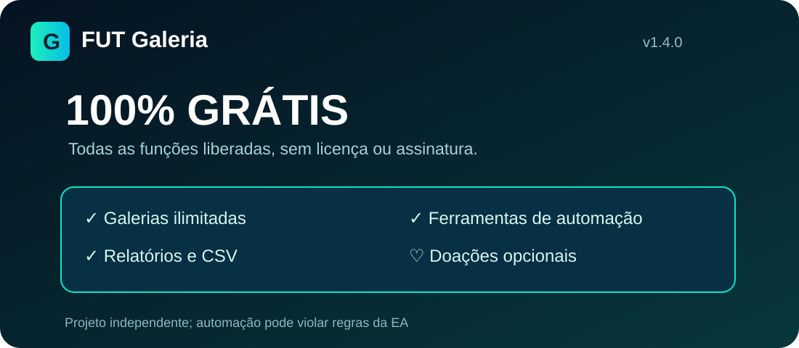

# FUT Galeria — totalmente gratuito

**Extensão independente para acompanhar galerias do EA FC Ultimate Team.** Disponível em português, inglês e espanhol.

> **Nova versão v1.4.0:** código gratuito concluído e em testes. O ZIP ainda precisa ser anexado a uma nova Release. **A versão v1.3.1-beta atualmente disponível é antiga e ainda contém referências a FREE/PRO.** Não compre licenças nem pague para desbloquear funções.

## Todos os recursos gratuitos

| Recurso | Acesso |
|---|---|
| Galerias | Ilimitadas |
| Compra automática no time atual | Disponível |
| Troca automática entre times | Disponível |
| Listagem e limpeza de transferências | Disponíveis |
| Estatísticas de lucro e CSV | Disponíveis |
| Planejamento, temas e backup | Disponíveis |
| Alertas de preço | Até 200 (limite técnico) |
| Cadastro, assinatura e chave de licença | **Não são necessários** |

O modo teste inicia ativado em cada sessão; ative operações reais somente após compreender os riscos.

## Download e instalação

A versão **v1.4.0-beta** será disponibilizada em [Releases](https://github.com/Ericklucenaa/FutGaleria/releases) após o envio do pacote atualizado. Baixe sempre o ZIP da seção **Assets** da versão correta, nunca o ZIP automático de código-fonte.

Após baixar: extraia o arquivo, abra `chrome://extensions`, habilite Modo do desenvolvedor, escolha **Carregar sem compactação** e selecione `FutGaleria_Chrome`, que contém `manifest.json`.

## Apoie o projeto

❤️ O FUT Galeria é **gratuito para todos**. Doações são **totalmente voluntárias** e não concedem acesso privilegiado ou recursos exclusivos.

**O link de doação ainda está sendo configurado.** Até existir um destino verificado, não envie dinheiro para terceiros que se apresentem como desenvolvedores. O botão de apoio da extensão direciona a esta seção.

## Aviso importante

A EA proíbe bots e compradores automáticos não autorizados no Ultimate Team. O uso pode levar a restrições ou bloqueios de contas, mesmo que a ferramenta seja gratuita. Este projeto é independente e **não é afiliado, patrocinado ou aprovado pela Electronic Arts**.

## Suporte e documentação

- [Relatar problemas](https://github.com/Ericklucenaa/FutGaleria/issues) — nunca envie senhas, cookies ou informações privadas
- [Instalação](docs/INSTALACAO.md) e [perguntas frequentes](docs/FAQ.md)

O repositório de desenvolvimento permanece privado. O código da extensão distribuída é inspecionável pelos usuários. O antigo sistema de licenças foi aposentado na edição gratuita.

---
*FUT Galeria — versão gratuita em preparação para distribuição.*
